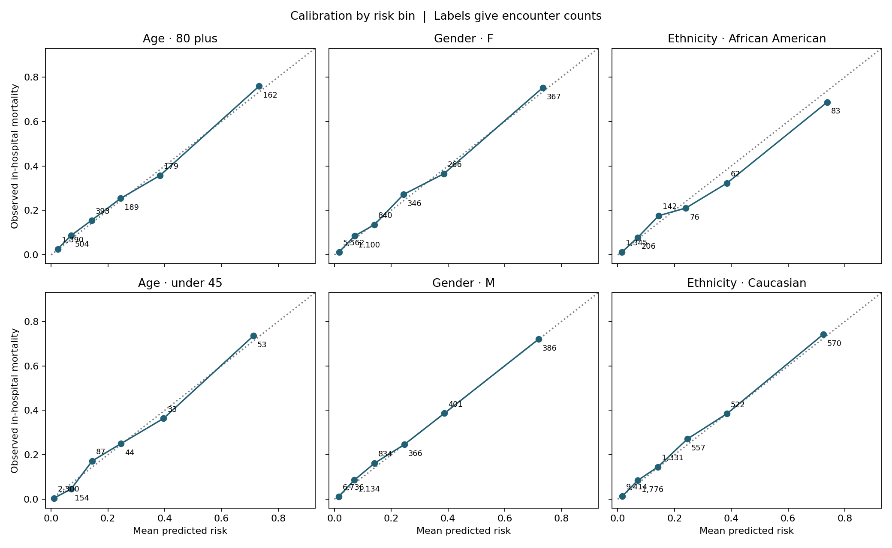

# Section 4 appendix

The primary analysis uses one shared review queue with a fixed capacity. The historical cutoff results below document how earlier analyses translated scores into flags. [Main report](outcomes.md)

## Subgroup performance at the historical 0.50 cutoff

| Grouping | Group | Patients | Deaths | Mortality | ROC-AUC | Recall at 0.50 | Precision at 0.50 |
|---|---|---:|---:|---:|---:|---:|---:|
| Overall | All | 18,343 | 1,583 | 8.63% | 0.9064 | 35.12% | 73.64% |
| Age | 45–64 | 6,012 | 412 | 6.9% | 0.920 | 35.7% | 71.4% |
| Age | 65–79 | 5,977 | 583 | 9.8% | 0.899 | 35.3% | 73.8% |
| Age | 80 and above | 2,817 | 376 | 13.3% | 0.852 | 32.7% | 75.9% |
| Age | Missing | 866 | 117 | 13.5% | 0.856 | 35.0% | 74.5% |
| Age | Under 45 | 2,671 | 95 | 3.6% | 0.948 | 41.1% | 73.6% |
| Gender | F | 8,481 | 744 | 8.8% | 0.905 | 37.1% | 75.2% |
| Gender | M | 9,857 | 837 | 8.5% | 0.908 | 33.2% | 72.0% |
| Gender | Missing † | 5 | 2 | 40.0% | 1.000 | 100.0% | 100.0% |
| Ethnicity | African American | 1,914 | 151 | 7.9% | 0.906 | 37.7% | 68.7% |
| Ethnicity | Asian † | 215 | 17 | 7.9% | 0.921 | 41.2% | 87.5% |
| Ethnicity | Caucasian | 14,170 | 1,244 | 8.8% | 0.903 | 34.0% | 74.2% |
| Ethnicity | Hispanic | 730 | 70 | 9.6% | 0.929 | 41.4% | 78.4% |
| Ethnicity | Missing | 281 | 22 | 7.8% | 0.935 | 40.9% | 90.0% |
| Ethnicity | Native American † | 175 | 15 | 8.6% | 0.945 | 46.7% | 87.5% |
| Ethnicity | Other/Unknown | 858 | 64 | 7.5% | 0.914 | 37.5% | 61.5% |

† Fewer than 20 deaths or fewer than 20 survivors. These estimates can be highly unstable. The full tables also give accuracy and confusion counts.

Ranking differed most visibly by age in this sample. AUC was **0.9481** below age 45 and **0.8521** at age 80 and above, with 95 and 376 deaths respectively. At 0.50, their recalls were **41.1%** and **32.7%**. The main report gives the hospital-cluster interval for the AUC difference. Precision also reflects how common the outcome is in each group. Across the entire cohort, the model flagged 556 deaths, missed 1,027 and flagged 199 survivors. [Primary metrics](../results/outcomes/as-recorded/metrics.json) · [Complete subgroup metrics](../results/outcomes/as-recorded/subgroup_thresholds.csv)

### How group error gaps vary with review workload

The common cutoff defines which patients would receive review. No clinical operating point has been established, so we examine both error-rate gaps across the full tested grid. We use the same cutoff for all groups at each row. The table shows one contrast for each grouping. The complete threshold table contains the other categories and their outcome counts.

| Score cutoff | Flags per 1,000 patients | Recorded F − M FNR | F − M FPR | Under 45 − ages 45–64 FNR | Under 45 − ages 45–64 FPR | African American − Caucasian FNR | African American − Caucasian FPR |
|---:|---:|---:|---:|---:|---:|---:|---:|
| 0.10 | 207.7 | +0.52 | +1.27 | -4.60 | -6.30 | -0.33 | -1.67 |
| 0.20 | 116.4 | -0.28 | -0.37 | -3.86 | -3.06 | +0.71 | +0.50 |
| 0.30 | 77.5 | +1.60 | -0.56 | -3.93 | -1.69 | -0.83 | +0.24 |
| 0.40 | 55.8 | -0.42 | -0.11 | -7.24 | -1.02 | -2.25 | +0.49 |
| 0.50 | 41.2 | -3.88 | -0.02 | -5.37 | -0.51 | -3.75 | +0.34 |

All gaps are in percentage points. A positive gap means the named group has a higher error rate than its reference group. The F-minus-M FNR changed sign across the grid. The under-45 FPR was lower than the ages 45–64 FPR at all five tested cutoffs. These rows are descriptive point estimates. Historical intervals for the 0.50 reference used within-group patient resampling. The cluster intervals in the main report apply to the 10% queue. [Complete subgroup threshold metrics](../results/outcomes/as-recorded/subgroup_thresholds.csv)

## Sensitivity to cutoff and APACHE input policy

We test two mechanisms that could change conclusions: the choice of cutoff and the treatment of existing APACHE risk scores used as model inputs. We report the full threshold grid from 0.10 to 0.50 in steps of 0.10. These comparisons quantify the workload and miss-rate trade-off and are exploratory. We also refit the four-fold ensemble under two alternative APACHE treatments, converting negatives to missing before bounded imputation or dropping both mortality probability inputs. All three models score the same holdout. These comparisons measure sensitivity to changes in preprocessing and inputs within this cohort. [Overall threshold grid](../results/outcomes/as-recorded/overall_thresholds.csv) · [Bounded imputation](../results/outcomes/negative-to-missing-bounded/metrics.json) · [APACHE fields removed](../results/outcomes/drop-probabilities/metrics.json)

Lowering the threshold from 0.50 to 0.30 flagged **252 additional observed deaths** (556 to 808) and **415 additional survivors** (199 to 614). Recall rose from 35.12% to 51.04% and precision fell from 73.64% to 56.82%. This describes the trade-off at two points on the reported grid. The recorded F-minus-M FNR gap also changed from −3.88 points at 0.50 to +1.60 points at 0.30. That reversal is descriptive and illustrates why a group ordering at one arbitrary cutoff should not be generalized. A separate validation protocol would be needed to select a threshold for a decision workflow.

| APACHE input policy | Holdout AUC | Recall at 0.50 | Missed deaths at 0.50 |
|---|---:|---:|---:|
| As recorded | 0.9064 | 35.12% | 1,027 |
| Negative to missing with bounded imputation | 0.9071 | 34.81% | 1,032 |
| Both risk fields removed | 0.9086 | 34.05% | 1,044 |

At equal capacity, all three models scored the same encounters. The table shows how the **subgroup gaps** changed. The age AUC and FPR gaps retained their directions and similar magnitudes. The age FNR gap shrank by 1.34 pp when both fields were removed. These are sensitivity estimates across three refits on the same data. They do not establish statistical equivalence.

| Contrast | As recorded | Negative to missing, bounded | Both probabilities removed |
|---|---:|---:|---:|
| 80+ minus under 45 | −0.0960 / +7.04 / +7.53 | −0.0955 / +6.51 / +7.46 | −0.0928 / +5.70 / +7.33 |
| Recorded F minus M | −0.0029 / +0.91 / −0.68 | −0.0022 / +1.25 / −0.71 | −0.0017 / +0.36 / −0.60 |
| African American minus Caucasian | +0.0029 / −1.63 / −0.29 | +0.0020 / −1.30 / −0.11 | +0.0029 / −0.96 / −0.24 |

Each cell gives AUC gap / FNR gap (pp) / FPR gap (pp) at 10% capacity. [Subgroup metrics](../results/review_budget/groups.csv) · [Contrasts](../results/review_budget/gaps.csv)

### Is the ensemble adding information beyond APACHE?

Of 18,343 held-out encounters, 16,279 had an original APACHE IVa **hospital** mortality probability in [0,1], including 1,417 deaths. We excluded 2,064 unavailable or invalid values from both arms. On identical encounters the ensemble achieved AUC 0.9092 versus 0.8623 for APACHE alone. With 1,627 slots each, the ensemble missed 584 deaths and APACHE missed 734. The paired AUC advantage was 0.0469 (hospital-bootstrap 95% CI 0.0406 to 0.0537). The ensemble placed 150 more eventual deaths in the queue. Its age FPR gap was smaller (+7.18 versus +8.51 pp), while its age FNR gap was larger (+10.42 versus +7.26 pp). Better overall ranking therefore coexisted with a larger age disparity on one error metric. APACHE probabilities are rounded, so the precise allocation of its last slots can depend on the tie rule. Results apply to encounters with a valid recorded score. [Paired hospital-bootstrap AUC contrast](../results/review_budget/baseline_comparison.csv) · [Matched subgroup contrasts](../results/review_budget/gaps.csv)

### Does a score mean the same thing across risk levels?

Within the 80+ group the overall mean understates predicted-versus-observed variation. For scores above 5% through 10%, the mean prediction was 7.1% and 44 of 504 encounters ended in death (8.7%). Above 30% through 50%, the mean prediction was 38.4% and 64 of 179 ended in death (35.8%). The direction changes across bins. The figure uses identical bin edges across groups and labels each point with its denominator. Sparse high-risk bins can move substantially with a few outcomes. The supplemental table gives Brier scores and the intercept and slope jointly fitted by logistic regression of outcome on logit score, with ideal values 0 and 1. These are descriptive diagnostics. [Bin counts and deaths for every group](../results/review_budget/calibration_bins.csv) · [Calibration coefficients and Brier scores](../results/review_budget/calibration_summary.csv)



### Do the gaps persist at held-out hospitals?

One group shuffle split (seed 420) randomly selected 30 of 147 hospital IDs, with all encounters from the other 117 hospitals used for development. This table describes the original draw. We reused this previously inspected split to examine fairness. Its 18,493 test encounters include 1,390 deaths and overlap the primary test set by 3,713 encounters. This is a supplementary internal transfer check. No patient or hospital crosses the training/test boundary within this split. The same pooled 10% rule selected 1,849 encounters. The table gives cluster-bootstrap pointwise 95% intervals.

| Contrast | Group sizes, deaths / encounters | AUC gap (CI) | FNR gap, pp (CI) | FPR gap, pp (CI) |
|---|---|---:|---:|---:|
| 80+ minus under 45 | 350 / 2,907 vs 83 / 2,635 | −0.063 (−0.105, −0.008) | −8.58 (−29.67, +5.15) | +7.97 (+6.73, +9.70) |
| Recorded F minus M | 633 / 8,434 vs 756 / 10,054 | −0.002 (−0.019, +0.015) | −0.32 (−4.50, +3.84) | +0.84 (−0.30, +1.65) |
| African American minus Caucasian | 71 / 1,208 vs 1,166 / 15,377 | +0.007 (−0.021, +0.032) | +5.71 (−5.48, +15.78) | +1.06 (−0.47, +2.56) |

The older group's FPR gap persists after nine-comparison adjustment (+6.05 to +10.26 pp). Its AUC gap points in the same direction as in the primary cohort, though its adjusted interval includes zero (−0.124 to +0.016). Its FNR gap reverses direction. Among the 17 hospitals with at least 20 deaths and 20 survivors, site FNR ranged from 17.9% to 58.3%, FPR from 3.1% to 25.6%, and AUC from 0.752 to 0.968. These unadjusted ranges describe site variation and include sampling noise. A pooled capacity does not guarantee equal review volume at each hospital. [Hospital-level counts and performance](../results/review_budget/sites.csv) · [Intervals](../results/review_budget/intervals.csv)

## Reproduction

Run from the repository root:

```sh
.venv/bin/python -m src.outcomes
.venv/bin/python -m src.outcomes --policy negative-to-missing-bounded
.venv/bin/python -m src.outcomes --policy drop-probabilities
.venv/bin/python -m src.hospital_validation
.venv/bin/python -m src.review_budget
.venv/bin/python -m src.age_case_mix
.venv/bin/python -m src.hospital_split_sensitivity
```
